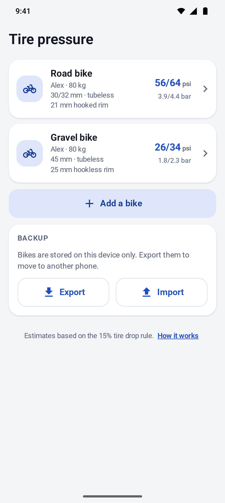
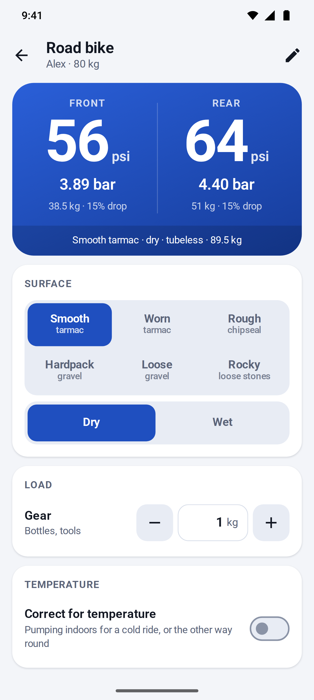
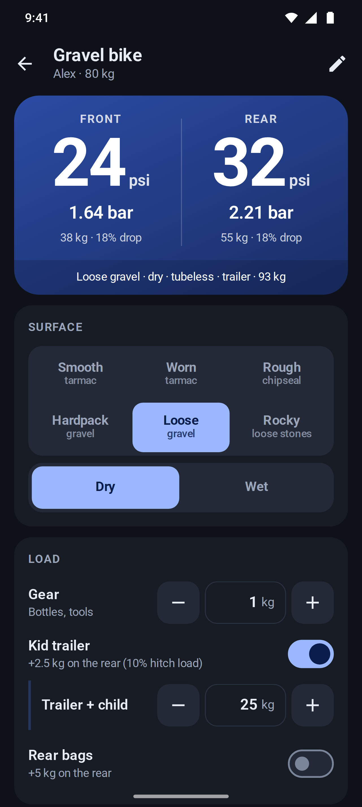
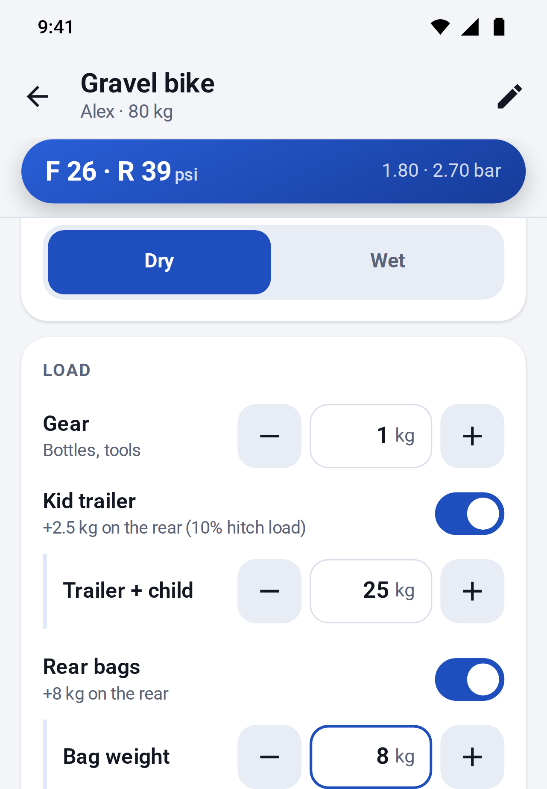
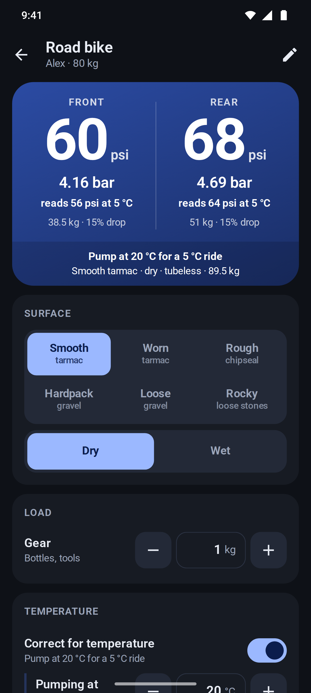
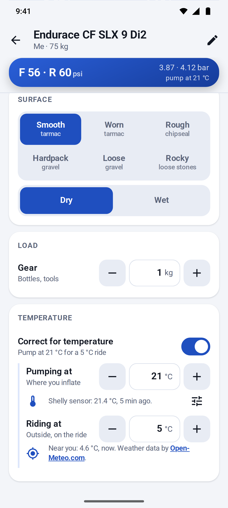
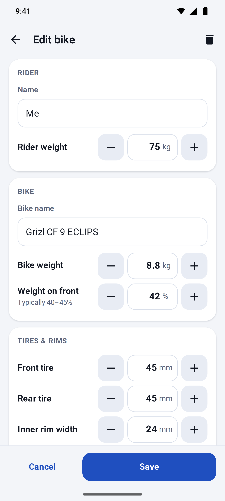
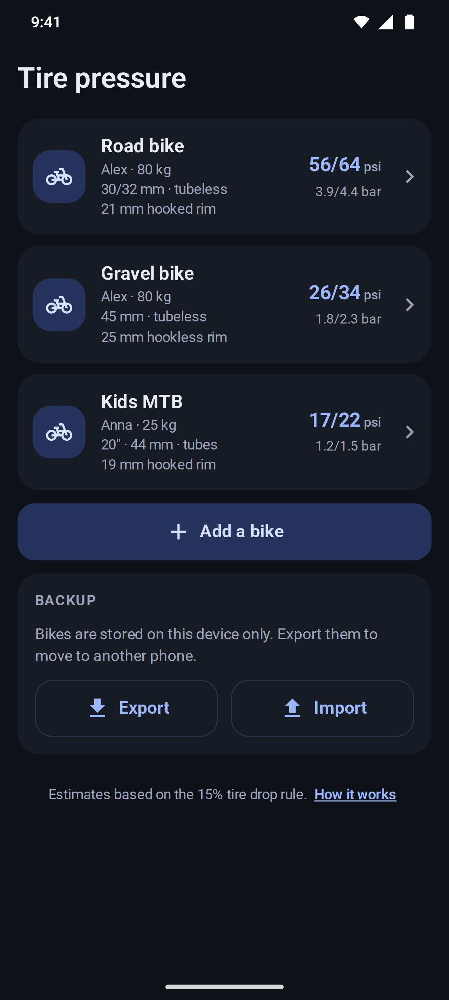
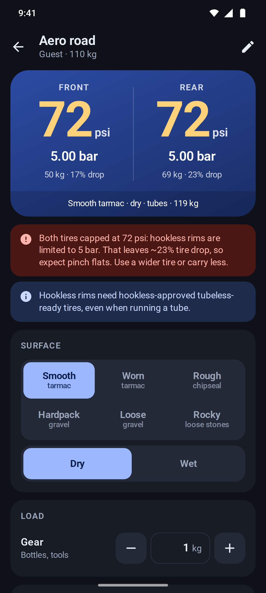

# Tire Pressure

An offline-first PWA that recommends front and rear tire pressures for each bike and rider in the family.

**App:** https://redsun82.github.io/tire-pressure/ (on Android Chrome: menu → *Add to home screen* / *Install app*)

| Bikes | Road | Gravel + trailer | Loads, keyboard up | Pumped indoors, cold ride | Temperatures looked up | Edit | Kid's 20″ bike | Warnings |
|---|---|---|---|---|---|---|---|---|
|  |  |  |  |  |  |  |  |  |

## Using it

- **One profile per bike and rider.** A profile holds the rider's weight, the bike (with the weight of a rear hub motor, if it has one), its wheel size (700c / 29″ down to 12″), tire widths (front and rear can differ), inner rim width, tubeless or tubes, hooked or hookless rims, the front/rear weight split, an optional pressure correction, optional tire and rim pressure limits, and which loads the bike can take: a kid trailer (with its hitch load) and rear bags. Loads a bike can't take don't show on its ride screen.
- **Per ride** you pick the surface, dry or wet, and the load: gear (1 kg by default), kid trailer (trailer + child, 25 kg by default) and rear bags (5 kg by default). The app remembers all of it per bike, and turning the trailer or bags off keeps their weight for next time. When the big result card is scrolled away (for example with the keyboard up), a compact "F 25 · R 32 psi" bar stays under the title.
- **Rear hub motor** (optional, 0 kg by default): for an e-bike with the motor in the rear hub, enter the whole bike's weight as the bike weight and the motor's share of it under *Rear hub motor*. The app puts the motor's weight entirely on the rear wheel and splits the rest with the front share, so the front share is of the weight without the motor (most bikes: 40–45%; see *1. Wheel load* below to measure it). The motor can't weigh more than the bike, or more than 10 kg. Lowering the bike weight below it lowers it to match, and the editor restores it if the bike weight goes back up before saving.
- **Pressure correction** (optional, 0 by default): raises or lowers both wheels of a bike by −15% to +15%, for a tire casing that is more supple or stiffer than the model assumes, or for how you like the bike to feel. When it isn't 0 it shows next to the bike's pressures in the list ("+5%") and in the line under the ride screen's result ("+5% correction"), so it is never a hidden factor.
- **Temperature** (optional, off by default): when you pump somewhere warmer or colder than you ride, for example indoors before a winter ride, switch on *Correct for temperature* and set where you pump and the ride temperature (both 20 °C at first). The big numbers, the compact bar and the bike list then show what to **pump to**, marked "pump at 20 °C", and each wheel shows what it will read on the ride ("reads 56 psi at 5 °C"). The temperatures are remembered per bike, also while the switch is off.
- **Looking the temperatures up:** when the temperature correction is on, opening a bike (or switching the correction on) sets *Riding at* to the current outside temperature near you, and *Pumping at* to the reading of a [Shelly](https://www.shelly.com/) sensor if you set one up, with no taps. That happens once per visit to the bike and never over a temperature you set yourself; the buttons next to them (*Use local weather*, *Read Shelly sensor*) look it up again. If you turned location access down, the app doesn't ask again until you tap. Failures are a quiet line, not an alert. The Shelly sensor (such as an H&T) is read through Shelly Cloud, so the sensor can stay on an isolated network. Set it up once with the server and *Authorization cloud key* from the Shelly app (*User settings*) and the sensor's device ID. Battery sensors report their last reading while they sleep, so the app shows how old it is and flags readings older than 12 hours. Values are rounded to whole degrees and kept within −20…45 °C, like typed ones.
- Results are in **psi** (pumps read in psi), with **bar** next to them, also in the bike list. Inputs are in kg and mm.
- **Privacy:** with the temperature correction off, nothing is fetched. The weather lookup sends your position rounded to two decimals (about 1 km) to [Open-Meteo](https://open-meteo.com/), with no account. The Shelly cloud key can control every device on its account, so it is kept apart from the bikes: it stays on the device, is never exported, and is only sent to a `shelly-….shelly.cloud` server.
- Everything is stored on the device (`localStorage`). If storage is blocked, the app still works, without saved bikes, and says that changes won't be saved. Use **Export** and **Import** on the home screen to back up or move bikes to another phone. Import merges by profile id. Bikes saved or exported before load capabilities existed keep any trailer or bags that were switched on, bikes from before wheel sizes existed are 700c, bikes from before the pressure correction have none (0%), and bikes from before the rear hub motor have none (0 kg). A motor heavier than its bike's weight, or than 10 kg, is lowered to match.
- The app starts with no bikes: add one with **Add a bike**, or **Import** a backup.

## Security

- **The Shelly cloud key** is stored unencrypted in this browser's `localStorage`. It is never exported, and it is only sent to the `shelly-….shelly.cloud` server you set up.
- It is a **full-control key**: whoever has it can control every device on the Shelly account, not just read the sensor.
- A **Content Security Policy** in the built page (a `<meta>` tag, as GitHub Pages can't send headers) only runs the app's own scripts and styles, with no inline code or `eval`, and only lets the page contact Shelly Cloud and Open-Meteo. Injected script doesn't run, and the page's requests can only go to the app itself and those two services.
- **What it can't protect against:** other pages on `redsun82.github.io` share this origin, and so its `localStorage`, without this policy; someone with access to the unlocked device can read the key from the browser; and a compromised dependency is bundled into the app's own scripts, which the policy allows.
- **If the key leaks**, change the Shelly account password: that gives the account a new key. Then enter the new key in the app's sensor setup.

## The pressure model

The model is our own implementation. Every coefficient lives in [`src/model/coefficients.ts`](src/model/coefficients.ts), and the computation is in [`src/model/pressure.ts`](src/model/pressure.ts).

The SRAM/Zipp and Silca calculators are proprietary, and we did not copy their maths. We did use outputs of the SRAM AXS calculator to calibrate two constants and as test references (see *Validation* below), and the step between two of Silca's surface categories for the rocky surface.

### 1. Wheel load

```
system  = rider + bike + gear
split   = system − rear hub motor
front   = split × front share
rear    = split × (1 − front share) + rear hub motor + trailer tongue load + rear bags
```

- **Front share** is per bike, and applies to everything but a rear hub motor. New bikes start at 43%, typical of road endurance geometry; gravel bikes with long chainstays are closer to 42%. Most bikes with a seated rider are 40–45%. To measure yours, put the front wheel on a bathroom scale while seated in riding position, with both wheels level and the gear on, but no trailer or rear bags: the front share is `front scale reading / (rider + bike + gear − rear hub motor)`. The motor adds nothing to the front reading, so it is left out of the total.
- **Rear hub motor:** part of the bike weight (0 by default, at most the bike weight and 10 kg) that sits on the rear axle, so all of it goes on the rear wheel instead of being split. For example, a 14.3 kg e-gravel bike with a 3.5 kg rear hub motor and a 43% frame puts 3.5 × 43% ≈ 1.5 kg more on the rear than splitting the whole bike would. At 0 the loads are exactly the same as without it.
- **Kid trailer:** the hitch sits on the rear axle, so only the tongue load reaches the bike. That defaults to 10% of trailer + child (set per ride, 25 kg by default; the percentage is set per bike) and is added to the rear wheel. The trailer's own wheel carries the rest.
- **Rear bags:** their full weight is added to the rear wheel.

### 2. Effective width

A tire measures wider on a wider rim. Following ETRTO and published measurements (tire makers, bicyclerollingresistance.com), the as-mounted width grows by about **0.4 mm per mm** of inner rim width:

```
W = nominal + 0.4 × (inner rim − reference rim)
reference rim = 19 mm (tires ≤ 32 mm), 21 mm (≤ 42 mm), 23 mm (wider)
```

### 3. Base pressure: 15% tire drop

The target is the pressure at which the tire compresses about **15% of its height** under that wheel's load. This is Frank Berto's rule from his measurements published in *Bicycle Quarterly*, summarised by Rene Herse in [Finding the perfect tire pressure](https://www.renehersecycles.com/finding-the-perfect-tire-pressure/).

```
P_base [psi] = 870 · L^0.8 / W^1.65         (L = wheel load in kg, W = effective width in mm)
```

How the constants were chosen:

- Berto published a chart, not a formula. A widely circulated community curve fit of that chart is `P = 153.6 · L_lb / W^1.5785 − 7.1685`. We could not re-verify it against the original chart, so it is an approximation of an approximation.
- We keep that shape's steep width dependence. `k` and the width exponent `b` are **fitted to six SRAM AXS calculator outputs** (see *Validation*), minimising the worst deviation of our front/rear mean from SRAM's, with the load exponent, our weight split and the surface multipliers held fixed. The fit gives `k = 870`, `b = 1.65`, close to the community fit's 1.58. Every case lands within 4% of SRAM.
- Our first version anchored only on the Berto fit (`k = 1490`, `b = 1.82`). It ran 2–14% below SRAM, most on wide tires.
- The load exponent `a = 0.8` is a **deliberate choice**. Berto's fit is nearly linear in load with a negative offset, which gives implausibly low pressures for light loads on wide tires (about 14 psi for a 45 mm front tire carrying 25 kg). A sub-linear load term keeps light riders and front wheels sensible. At a 45 kg wheel load the model is 0–20% above the Berto fit: close on wide tires, higher on narrow ones, where SRAM also runs above it.

### 4. Wheel size

The base pressure is calibrated on 700c wheels. A smaller wheel has a shorter contact patch at the same tire drop, so it needs more pressure to carry the same load. Each bike has a wheel size, stored as its ETRTO bead seat diameter (the second number on the sidewall, e.g. 47-**622**): 622 (700c / 29″), 584 (650b / 27.5″), 559 (26″), 507 (24″), 406 (20″), 355 (18″), 305 (16″) or 203 (12″).

The patch is roughly an ellipse. For a drop `d`, it is about `2·√(D·d)` long for an outer wheel diameter `D` and `2·√(H·d)` wide for a tire height `H`, so its area is about `π·d·√(D·H)`. At the same relative drop, the pressure therefore scales with `1/√D`. (The same geometry gives `1/H^1.5` for the width, close to the fitted 1.65 above.) Taking the tire height as its effective width `W`:

```
P = P_base × √((622 + 2W) / (BSD + 2W))
```

The factor is exactly 1 on 700c, so 700c results don't change. Between adult sizes it is small: a 650b × 47 mm wheel has about the outer diameter of a 700c × 30 mm one and gets about 3% (1 psi at gravel pressures) more than a 700c wheel with the same tire. For kids' bikes it matters: +20% on 20 × 1.75″ and +35% on 16 × 1.75″ (19 mm rims). It doesn't depend on the load, so a light kid still gets much less than an adult on the same wheels.

The SRAM AXS calculator raises pressure about 2.8× more than this (in log terms) for smaller wheels; see *Validation*. We keep the contact patch geometry rather than fit SRAM's outputs, which would need much more on kids' wheels (+130% on 16″) with nothing to check them against.

### 5. Conditions

The base pressure is multiplied by:

| Factor | Multiplier | Why |
|---|---|---|
| Smooth tarmac | 1.00 | Baseline |
| Worn tarmac | 0.94 | |
| Rough tarmac / chipseal | 0.87 | Surface "breakpoint": on rougher surfaces, lower pressure reduces suspension losses (Silca, Rene Herse/BQ and bicyclerollingresistance.com roll-down tests) |
| Hardpack gravel | 0.90 | |
| Loose gravel | 0.82 | |
| Rocky path (loose stones) | 0.73 | Hardpack × 0.808, the step between the smoothest and roughest gravel categories of Silca's Pro calculator |
| Wet | × 0.95 | More grip from a larger contact patch |
| Inner tubes | × 1.05 | Small margin against pinch flats (tubeless is the baseline) |

The surface values are our own conservative picks within the ranges that research suggests. Rocky is the exception: it extends our gravel steps with Silca's. Our loose/hardpack step (0.911) already matches Silca's step to its middle gravel category (0.909), so rocky takes the step to its roughest one. The SRAM AXS calculator has no rougher gravel terrain to compare with (gravel is only dry or wet), so rocky has no SRAM reference.

Last, each bike's **pressure correction** (−15% to +15%, 0 by default) multiplies the result: `× (1 + correction / 100)`. It is for what the model can't see, such as a supple or stiff tire casing, and for personal ride feel, so it is the same for both wheels. It applies to the ride pressure, before the limits (step 7, which still cap it) and the temperature correction (step 6). The 15% drop base stays the same, so the estimated tire drop follows the corrected pressure: a negative correction shows more drop and can bring up the drop warnings. At 0 the results are exactly the same as without it.

### 6. Temperature

Steps 1–5 give the pressure the tire should have **on the ride**. Air in a tire is close to an ideal gas at constant volume (the casing barely stretches), so its *absolute* pressure scales with *absolute* temperature ([Gay-Lussac's law](https://en.wikipedia.org/wiki/Gay-Lussac%27s_law)). Gauges read pressure above the atmosphere, so:

```
P_pump = (P_ride + 14.696 psi) × T_pump / T_ride − 14.696 psi      (T in kelvin = °C + 273.15; 14.696 psi = 1.01325 bar)
```

For example, 56 psi for a 5 °C ride means pumping to (56 + 14.696) × 293.15 / 278.15 − 14.696 ≈ **59.8 psi** at 20 °C: roughly 1 psi per 4 °C at road pressures and per 6 °C at gravel pressures. Pumping somewhere colder than the ride gives a lower pump pressure.

Only the air temperature is modelled. A bike tire hardly heats up from riding itself (unlike car tires, it flexes little and carries little load), so we ignore that. After a temperature change, the air in the tire takes some minutes to follow, so check the gauge once the tire has settled.

The limits hold at **both** temperatures: a maximum (hookless 5 bar, tire or rim max) is checked where the tire is warmer, so when pumping indoors the pump pressure is capped, and when riding in the heat the ride pressure is. The tire minimum applies to the ride pressure. Displayed pump values are rounded within the limits converted to the pump temperature, so the value you pump to never reads past a limit on the ride. If the temperatures make the tire minimum unreachable under a maximum, the app caps at the maximum and says so. The other way round, pumping very cold for a hot ride can ask for less than nothing at the pump (an almost empty tire already reads a few psi once warmed up): the app never recommends less than 1 psi, and warns that the target can't be reached. If even 1 psi at the pump would go over a maximum on the ride, it shows "—" instead of a pressure and asks you to pump closer to the ride temperature. The "reads … psi" line is what the displayed pump value reads on the ride, so it can differ by a psi from the target after rounding.

The ride temperature can come from [Open-Meteo](https://open-meteo.com/en/docs)'s current 2 m air temperature (weather data by [Open-Meteo.com](https://open-meteo.com/), [CC BY 4.0](https://creativecommons.org/licenses/by/4.0/)), and the pump temperature from a Shelly sensor through the [Shelly Cloud API](https://shelly-api-docs.shelly.cloud/cloud-control-api/communication) (on Gen2+ devices the lowest-numbered `temperature:<id>` with a reading, so a built-in sensor such as the H&T's `temperature:0` before add-on probes from `temperature:100`; `tmp` on Gen1 sensors such as the H&T). A relay's internal chip temperature is never used as the room temperature. The code is in [`src/model/weather.ts`](src/model/weather.ts) and [`src/model/shelly.ts`](src/model/shelly.ts).

### 7. Limits and warnings

- **Hookless rims** are capped at **5 bar / 72.5 psi** (ETRTO / ISO). Optional tire max, tire min and rim max limits from the sidewall or rim manual also clamp the result. Displayed values never round past a limit, clamped or not: a 72.5 psi hookless cap shows as 72, and a 63.8 psi result under a 63.9 psi tire max shows as 63. When no whole step fits between the limits, up to two more decimals are shown (30.3 psi between 30.2 and 30.4); equal limits show the limit itself (min = max = 30 psi is 2.0684 bar). The maximum always wins: if the tire minimum is above the rim or tire maximum, the app caps at the maximum, flags the combination as unsafe, and the editor won't save it.
- **Estimated tire drop** at the recommended pressure is `15% × P_base / P`, shown under each wheel. The app warns above 20% (tubeless: risk of rim strikes) or 18% (tubes: risk of pinch flats). Rocky ground asks for about 21% on purpose, so there its info note gives the drop instead, and the warning appears only when a limit pushes the drop further.
- Info notes cover very low pressures (< 18 psi), hookless rims with tubes, front shares outside 30–55%, and rocky ground, where sharp rocks can hit the rim at these pressures, so tire inserts are worth considering.

### Validation

- The unit tests (`src/model/*.test.ts`) check monotonicity in load, width, rim width and surface, unit conversion and rounding, the trailer and bag maths, the per-bike pressure correction and the rear hub motor (including that 0 changes nothing for either), the temperature correction (including the example above and its interplay with the limits), the limits and warnings, storage normalisation, load weights and temperatures surviving the on/off switches, and import/export.
- **SRAM AXS references.** [`src/model/sram-axs.fixtures.ts`](src/model/sram-axs.fixtures.ts) holds outputs of the [SRAM AXS tire pressure calculator](https://axs.sram.com/guides/tire/pressure), retrieved 2026-10-19 (Standard casing, 700c unless noted, kg, psi). SRAM "Road" maps to our smooth tarmac and "Gravel" to our hardpack. SRAM takes one system weight, which we split with our own front share. The tests require our front/rear mean within ±7% of SRAM's on road and ±10% on gravel:

  | Case | Rider / bike + gear | Tires F/R, rim | SRAM F/R | Ours F/R |
  |---|---|---|---|---|
  | Road bike, road dry | 75 / 8.5 kg | 30/34 mm, hooked 22 | 59.2 / 53.2 | 52.3 / 55.8 |
  | Road bike, road wet | 75 / 8.5 kg | 30/34 mm, hooked 22 | 53.3 / 47.9 | 49.7 / 53.0 |
  | Gravel bike, gravel dry | 75 / 9.8 kg | 45/45 mm, hookless 24 | 28.6 / 30.4 | 25.2 / 32.6 |
  | Gravel bike, road dry | 75 / 9.8 kg | 45/45 mm, hookless 24 | 31.8 / 33.8 | 28.0 / 36.2 |
  | 28 mm reference | 70 / 8 kg | 28/28 mm, hooked 21 | 61.7 / 65.6 | 56.5 / 70.8 |
  | Heavy rider | 100 / 9 kg | 32/32 mm, hooked 21 | 62.7 / 66.7 | 59.6 / 74.6 |

  Our split differs from SRAM's: we put more pressure in the rear, which carries ~57% of the weight. SRAM puts more in the front when the front tire is narrower. Only the mean is calibrated.
- **Kid.** SRAM gives a 35 kg kid on a 10 kg bike with 40 mm tires 29.6 / 31.5 psi on gravel, close to adult values; its gravel results seem not to go much below 30 psi. That case is not a calibration target. Instead, a test requires a clearly lower pressure than an adult's on the same tires (ours: ~19 / 24 psi). Another requires a 25 kg kid on 20″ and 16″ wheels to get at least 15% more than on 700c with the same 44 mm tires, and still less than 0.7× an adult on those wheels.
- **Wheel size.** SRAM only offers 650b (and 571 mm) besides 700c for road and gravel, and 26″ only for mountain bikes, so there is no reference below 26″. The same inputs on both wheel sizes (26″ cases on MTB Cross Country with 2.2″ = 56 mm tires, hooked 25 mm rims, 11 kg bike):

  | Case | SRAM 700c F/R | SRAM small F/R | SRAM step | Our step |
  |---|---|---|---|---|
  | Gravel bike on 650b, gravel | 28.6 / 30.4 | 30.9 / 32.8 | +8.0% | +2.8% |
  | 650b × 47 mm, hooked 24, gravel | 29.7 / 31.6 | 32.1 / 34.1 | +8.0% | +2.8% |
  | Road bike on 650b, road | 59.2 / 53.2 | 64.0 / 57.5 | +8.1% | +2.9% |
  | 35 kg kid on 650b, gravel | 29.6 / 31.5 | 32.0 / 34.0 | +8.0% | +2.8% |
  | 75 kg rider on 26″ | 23.1 / 24.6 | 26.2 / 27.9 | +13.4% | +4.6% |
  | 35 kg kid on 26″ | 18.1 / 19.3 | 20.6 / 21.9 | +13.6% | +4.6% |

  We go the same way, with about 0.36 of SRAM's step in log terms. That is a deliberate divergence (see *4. Wheel size*): the tests require our step to be between a quarter and all of SRAM's. SRAM's step would fit an exponent of about 1.4 instead of our 0.5, which would give +130% instead of +35% on 16″ wheels.
- The example bike tests also assert broad sanity ranges from published guidance for a ~80 kg rider: 28–35 mm road tubeless at roughly 45–70 psi, 45 mm gravel tubeless at roughly 20–40 psi.
- On top of that, a ±5% **regression snapshot** pins the model's own current outputs, so changing a coefficient is a visible, deliberate change.

### Example bikes

The tests and screenshots use two generic example bikes from [`src/model/example-bikes.fixtures.ts`](src/model/example-bikes.fixtures.ts); they are not part of the app. Both have an 80 kg rider and 1 kg of gear:

| | Road bike | Gravel bike |
|---|---|---|
| Bike | 8.5 kg | 9.5 kg |
| Tires | 30 mm front, 32 mm rear, tubeless | 45 mm, tubeless |
| Rim | 21 mm inner, **hooked** | 25 mm inner, **hookless** |
| Split | 43 / 57 | 42 / 58 |
| Loads | none | kid trailer and rear bags |
| Smooth / dry | ~56 / 64 psi | ~29 / 38 psi |
| Rough chipseal / wet | ~47 / 53 psi | |
| Hardpack / dry | | ~26 / 34 psi |
| Loose / dry, with the trailer | | ~24 / 32 psi |

## Development

```sh
npm ci
npm run dev          # Vite dev server
npm test             # Vitest (model + storage)
npm run build        # type-check + production build (PWA, service worker, icons)
npm run screenshots  # Playwright: Pixel 10 Pro screenshots → docs/screenshots/, and CSP checks
```

- **Stack:** Vite + TypeScript (no framework), [vite-plugin-pwa](https://vite-pwa-org.netlify.app/) (Workbox precache, auto update), and icons generated from `public/icon.svg` by `@vite-pwa/assets-generator`.
- **Screenshots** render the app at the Pixel 10 Pro reference size: 410×912 CSS px at DPR 3.125, in light and dark. A simulated status bar and gesture bar exercise the safe-area insets. The same run checks that every touch target is at least 48 CSS px. Install the browser first with `npx playwright install chromium`.
- **Content Security Policy:** `vite.config.ts` adds it to builds only, as the dev server needs inline scripts for hot reload. Every Playwright test fails on a CSP violation, and `screenshots/csp.spec.ts` checks that the lookups and the service worker work under it and that other servers and injected code are blocked. The screenshots' device chrome is served from the app's origin for the same reason: inline styles are blocked.
- **CI** (`.github/workflows/ci.yml`) runs the tests, the build and the screenshots on every PR. **Deploy** (`.github/workflows/deploy.yml`) publishes `dist/` to GitHub Pages on every push to `main`.

## Disclaimer

These are estimates and a starting point. Never exceed the limits printed on your tire or rim. Adjust to feel: if the bike feels harsh, go lower; if it feels squirmy or the rim bottoms out, go higher.
