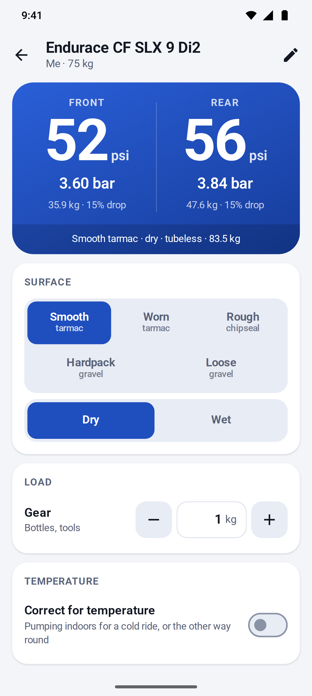
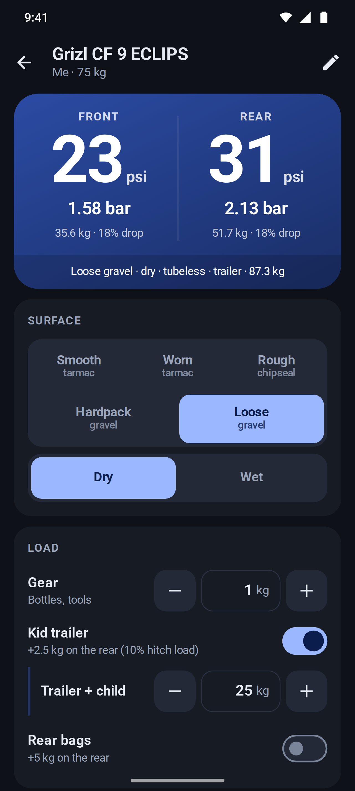
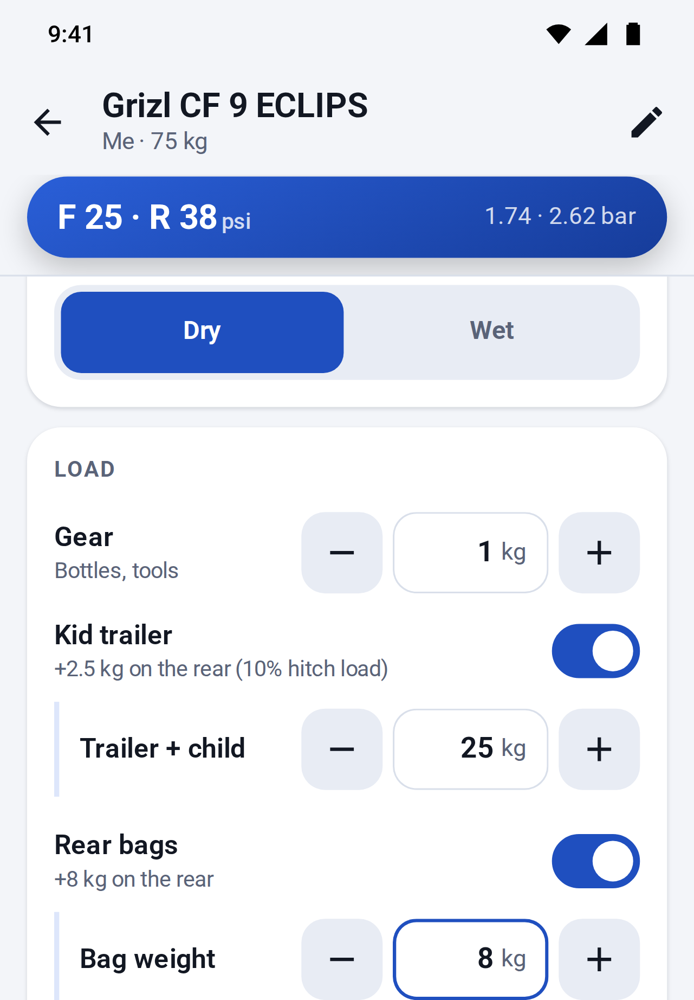
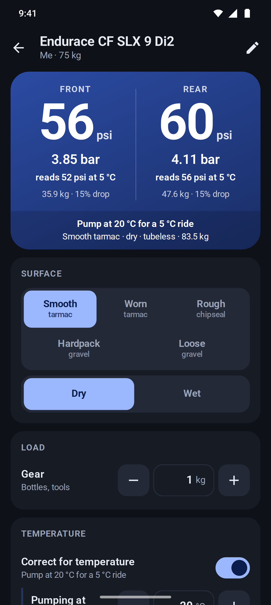

# Tire Pressure

An offline-first PWA that recommends front and rear tire pressures for each bike and rider in the family.

**App:** https://redsun82.github.io/tire-pressure/ (on Android Chrome: menu → *Add to home screen* / *Install app*)

| Bikes | Road | Gravel + trailer | Loads, keyboard up | Pumped indoors, cold ride | Edit | Warnings |
|---|---|---|---|---|---|---|
|  |  |  |  |  |  |  |

## Using it

- **One profile per bike and rider.** A profile holds the rider's weight, the bike, tire widths (front and rear can differ), inner rim width, tubeless or tubes, hooked or hookless rims, the front/rear weight split, optional tire and rim pressure limits, and which loads the bike can take: a kid trailer (with its hitch load) and rear bags. Loads a bike can't take don't show on its ride screen.
- **Per ride** you pick the surface, dry or wet, and the load: gear (1 kg by default), kid trailer (trailer + child, 25 kg by default) and rear bags (5 kg by default). The app remembers all of it per bike, and turning the trailer or bags off keeps their weight for next time. When the big result card is scrolled away (for example with the keyboard up), a compact "F 25 · R 32 psi" bar stays under the title.
- **Temperature** (optional, off by default): when you pump somewhere warmer or colder than you ride, for example indoors before a winter ride, switch on *Correct for temperature* and set where you pump and the ride temperature (both 20 °C at first). The big numbers, the compact bar and the bike list then show what to **pump to**, marked "pump at 20 °C", and each wheel shows what it will read on the ride ("reads 56 psi at 5 °C"). The temperatures are remembered per bike, also while the switch is off.
- Results are in **psi** (pumps read in psi), with **bar** next to them, also in the bike list. Inputs are in kg and mm.
- Everything is stored on the device (`localStorage`). If storage is blocked, the app still works with the seeded bikes and says that changes won't be saved. Use **Export** and **Import** on the home screen to back up or move bikes to another phone. Import merges by profile id. Bikes saved or exported before load capabilities existed keep any trailer or bags that were switched on.
- The two seeded bikes are a Canyon Endurace CF SLX 9 Di2 and a Canyon Grizl CF 9 with ECLIPS. Edit or delete them as needed.

## The pressure model

The model is our own implementation. Every coefficient lives in [`src/model/coefficients.ts`](src/model/coefficients.ts), and the computation is in [`src/model/pressure.ts`](src/model/pressure.ts).

The SRAM/Zipp and Silca calculators are proprietary, and we did not copy their maths. We did use outputs of the SRAM AXS calculator to calibrate two constants and as test references (see *Validation* below).

### 1. Wheel load

```
system  = rider + bike + gear
front   = system × front share
rear    = system × (1 − front share) + trailer tongue load + rear bags
```

- **Front share** is per bike. The seeds use 43% for the Endurace (road endurance geometry) and 42% for the Grizl (440 mm chainstays, ~1100 mm wheelbase). Most bikes with a seated rider are 40–45%. To measure yours, put the front wheel on a bathroom scale while seated in riding position.
- **Kid trailer:** the hitch sits on the rear axle, so only the tongue load reaches the bike. That defaults to 10% of trailer + child (set per ride, 25 kg by default; the percentage is set per bike) and is added to the rear wheel. The trailer's own wheel carries the rest.
- **Rear bags:** their full weight is added to the rear wheel.

### 2. Effective width

A tire measures wider on a wider rim. Following ETRTO and published measurements (tire makers, bicyclerollingresistance.com), the as-mounted width grows by about **0.4 mm per mm** of inner rim width:

```
W = nominal + 0.4 × (inner rim − reference rim)
reference rim = 19 mm (tires ≤ 32 mm), 21 mm (≤ 42 mm), 23 mm (wider)
```

### 3. Base pressure: 15% tire drop

The target is the pressure at which the tire compresses about **15% of its height** under that wheel's load. This is Frank Berto's rule from his measurements published in *Bicycle Quarterly*, summarised by Rene Herse in [Finding the perfect tire pressure](https://www.renehersecycles.com/finding-the-perfect-tire-pressure/).

```
P_base [psi] = 870 · L^0.8 / W^1.65         (L = wheel load in kg, W = effective width in mm)
```

How the constants were chosen:

- Berto published a chart, not a formula. A widely circulated community curve fit of that chart is `P = 153.6 · L_lb / W^1.5785 − 7.1685`. We could not re-verify it against the original chart, so it is an approximation of an approximation.
- We keep that shape's steep width dependence. `k` and the width exponent `b` are **fitted to six SRAM AXS calculator outputs** (see *Validation*), minimising the worst deviation of our front/rear mean from SRAM's, with the load exponent, our weight split and the surface multipliers held fixed. The fit gives `k = 870`, `b = 1.65`, close to the community fit's 1.58. Every case lands within 4% of SRAM.
- Our first version anchored only on the Berto fit (`k = 1490`, `b = 1.82`). It ran 2–14% below SRAM, most on wide tires.
- The load exponent `a = 0.8` is a **deliberate choice**. Berto's fit is nearly linear in load with a negative offset, which gives implausibly low pressures for light loads on wide tires (about 14 psi for a 45 mm front tire carrying 25 kg). A sub-linear load term keeps light riders and front wheels sensible. At a 45 kg wheel load the model is 0–20% above the Berto fit: close on wide tires, higher on narrow ones, where SRAM also runs above it.

### 4. Conditions

The base pressure is multiplied by:

| Factor | Multiplier | Why |
|---|---|---|
| Smooth tarmac | 1.00 | Baseline |
| Worn tarmac | 0.94 | |
| Rough tarmac / chipseal | 0.87 | Surface "breakpoint": on rougher surfaces, lower pressure reduces suspension losses (Silca, Rene Herse/BQ and bicyclerollingresistance.com roll-down tests) |
| Hardpack gravel | 0.90 | |
| Loose gravel | 0.82 | |
| Wet | × 0.95 | More grip from a larger contact patch |
| Inner tubes | × 1.05 | Small margin against pinch flats (tubeless is the baseline) |

The surface values are our own conservative picks within the ranges that research suggests. They are not taken from any calculator.

### 5. Temperature

Steps 1–4 give the pressure the tire should have **on the ride**. Air in a tire is close to an ideal gas at constant volume (the casing barely stretches), so its *absolute* pressure scales with *absolute* temperature ([Gay-Lussac's law](https://en.wikipedia.org/wiki/Gay-Lussac%27s_law)). Gauges read pressure above the atmosphere, so:

```
P_pump = (P_ride + 14.696 psi) × T_pump / T_ride − 14.696 psi      (T in kelvin = °C + 273.15; 14.696 psi = 1.01325 bar)
```

For example, 56 psi for a 5 °C ride means pumping to (56 + 14.696) × 293.15 / 278.15 − 14.696 ≈ **59.8 psi** at 20 °C: roughly 1 psi per 4 °C at road pressures and per 6 °C at gravel pressures. Pumping somewhere colder than the ride gives a lower pump pressure.

Only the air temperature is modelled. A bike tire hardly heats up from riding itself (unlike car tires, it flexes little and carries little load), so we ignore that. After a temperature change, the air in the tire takes some minutes to follow, so check the gauge once the tire has settled.

The limits hold at **both** temperatures: a maximum (hookless 5 bar, tire or rim max) is checked where the tire is warmer, so when pumping indoors the pump pressure is capped, and when riding in the heat the ride pressure is. The tire minimum applies to the ride pressure. Displayed pump values are rounded within the limits converted to the pump temperature, so the value you pump to never reads past a limit on the ride. If the temperatures make the tire minimum unreachable under a maximum, the app caps at the maximum and says so.

### 6. Limits and warnings

- **Hookless rims** are capped at **5 bar / 72.5 psi** (ETRTO / ISO). Optional tire max, tire min and rim max limits from the sidewall or rim manual also clamp the result. Displayed values never round past a limit, clamped or not: a 72.5 psi hookless cap shows as 72, and a 55.8 psi result under a 55.9 psi tire max shows as 55. When no whole step fits between the limits, up to two more decimals are shown (30.3 psi between 30.2 and 30.4); equal limits show the limit itself (min = max = 30 psi is 2.0684 bar). The maximum always wins: if the tire minimum is above the rim or tire maximum, the app caps at the maximum, flags the combination as unsafe, and the editor won't save it.
- **Estimated tire drop** at the recommended pressure is `15% × P_base / P`, shown under each wheel. The app warns above 20% (tubeless: risk of rim strikes) or 18% (tubes: risk of pinch flats).
- Info notes cover very low pressures (< 18 psi), hookless rims with tubes, and front shares outside 30–55%.

### Validation

- The unit tests (`src/model/*.test.ts`) check monotonicity in load, width, rim width and surface, unit conversion and rounding, the trailer and bag maths, the temperature correction (including the example above and its interplay with the limits), the limits and warnings, storage normalisation, load weights and temperatures surviving the on/off switches, and import/export.
- **SRAM AXS references.** [`src/model/sram-axs.fixtures.ts`](src/model/sram-axs.fixtures.ts) holds outputs of the [SRAM AXS tire pressure calculator](https://axs.sram.com/guides/tire/pressure), retrieved 2026-10-19 (Standard casing, 700c, kg, psi). SRAM "Road" maps to our smooth tarmac and "Gravel" to our hardpack. SRAM takes one system weight, which we split with our own front share. The tests require our front/rear mean within ±7% of SRAM's on road and ±10% on gravel:

  | Case | Rider / bike + gear | Tires F/R, rim | SRAM F/R | Ours F/R |
  |---|---|---|---|---|
  | Endurace, road dry | 75 / 8.5 kg | 30/34 mm, hooked 22 | 59.2 / 53.2 | 52.3 / 55.8 |
  | Endurace, road wet | 75 / 8.5 kg | 30/34 mm, hooked 22 | 53.3 / 47.9 | 49.7 / 53.0 |
  | Grizl, gravel dry | 75 / 9.8 kg | 45/45 mm, hookless 24 | 28.6 / 30.4 | 25.2 / 32.6 |
  | Grizl, road dry | 75 / 9.8 kg | 45/45 mm, hookless 24 | 31.8 / 33.8 | 28.0 / 36.2 |
  | 28 mm reference | 70 / 8 kg | 28/28 mm, hooked 21 | 61.7 / 65.6 | 56.5 / 70.8 |
  | Heavy rider | 100 / 9 kg | 32/32 mm, hooked 21 | 62.7 / 66.7 | 59.6 / 74.6 |

  Our split differs from SRAM's: we put more pressure in the rear, which carries ~57% of the weight. SRAM puts more in the front when the front tire is narrower. Only the mean is calibrated.
- **Kid.** SRAM gives a 35 kg kid on a 10 kg bike with 40 mm tires 29.6 / 31.5 psi on gravel, close to adult values. It appears to floor around 30 psi. That case is not a calibration target. Instead, a test requires a clearly lower pressure than an adult's on the same tires (ours: ~19 / 24 psi).
- The seed bike tests also assert broad sanity ranges from published guidance for a ~75 kg rider: 28–35 mm road tubeless at roughly 45–70 psi, 45 mm gravel tubeless at roughly 20–40 psi.
- On top of that, a ±5% **regression snapshot** pins the model's own current outputs, so changing a coefficient is a visible, deliberate change.

### Seed bikes

| | Endurace CF SLX 9 Di2 (L) | Grizl CF 9 ECLIPS (L) |
|---|---|---|
| Bike | 7.5 kg | 8.8 kg |
| Tires | Schwalbe Pro One TLE 30 mm front, 34 mm rear | Schwalbe G-One RX Pro 45 mm |
| Rim | DT Swiss ARC 1100 DICUT, 22 mm inner, **hooked** | DT Swiss GRC 1400 SPLINE, 24 mm inner, **hookless** |
| Split | 43 / 57 | 42 / 58 |
| Smooth / dry, 75 kg rider, 1 kg gear | ~52 / 56 psi | ~28 / 36 psi (hardpack ~25 / 33) |

The GRC 1400 is a **hookless** rim, according to DT Swiss and retailer specs, so the 5 bar cap applies to the Grizl. DT Swiss also publishes per-width maximums for its hookless rims. We haven't verified those values, so they are not pre-filled. Add them under *Limits* if you have them.

## Development

```sh
npm ci
npm run dev          # Vite dev server
npm test             # Vitest (model + storage)
npm run build        # type-check + production build (PWA, service worker, icons)
npm run screenshots  # Playwright: Pixel 10 Pro screenshots → docs/screenshots/
```

- **Stack:** Vite + TypeScript (no framework), [vite-plugin-pwa](https://vite-pwa-org.netlify.app/) (Workbox precache, auto update), and icons generated from `public/icon.svg` by `@vite-pwa/assets-generator`.
- **Screenshots** render the app at the Pixel 10 Pro reference size: 410×912 CSS px at DPR 3.125, in light and dark. A simulated status bar and gesture bar exercise the safe-area insets. The same run checks that every touch target is at least 48 CSS px. Install the browser first with `npx playwright install chromium`.
- **CI** (`.github/workflows/ci.yml`) runs the tests, the build and the screenshots on every PR. **Deploy** (`.github/workflows/deploy.yml`) publishes `dist/` to GitHub Pages on every push to `main`.

## Disclaimer

These are estimates and a starting point. Never exceed the limits printed on your tire or rim. Adjust to feel: if the bike feels harsh, go lower; if it feels squirmy or the rim bottoms out, go higher.
